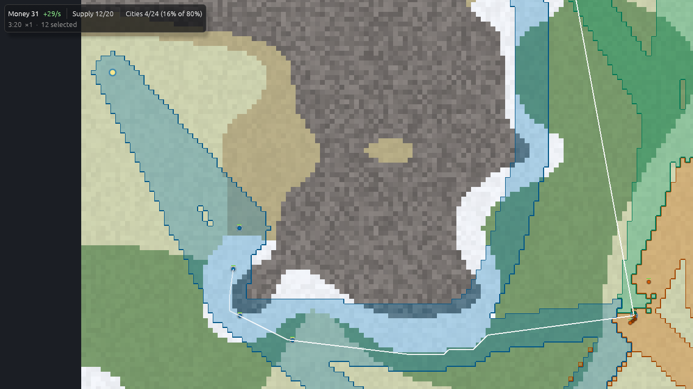

# Iron Dots

A minimalist real-time strategy game in Rust. Armies are dots on an
operational map, territory shifts as they move, cities pay for new troops, and
encircled armies starve. The goal of the project is a simulation that handles
**100 000 units on a 4096² map** at a fixed 30 ticks per second. It is fully
deterministic, which is what makes lockstep multiplayer and tiny replays
possible.

Free and open source (MIT OR Apache-2.0). The full spec (in Russian) is in
[`docs/spec-ru.md`](docs/spec-ru.md).



## Status

**Stage 1: simulation prototype** ✓
fixed-point SoA core, spatial grid, movement, combat with morale, replays, golden hashes on 4 platforms.

**Stage 2: playable version** ✓ (spec §8)

- [x] Cities and capitals, money (income, upkeep, purchases), territory painting and borders
- [x] Supply per pocket (connected territory), starvation, healing, city capture, victory (capital + 80% of cities)
- [x] A* pathfinding around mountains and costly terrain (per unit type), with a per-tick budget
- [x] Bots (`ai` crate) with three difficulty levels; bot-vs-bot matches play to victory in CI
- [x] wgpu renderer: tile map, territory tint, borders, instanced units and cities, paths, selection
- [x] Client (winit + egui): main menu, HUD, city panel, controls from spec §2.9, pause/speed, end-of-match charts, replays saved to `replays/`

**Stage 3: parallelism** ✓

- [x] rayon over fixed 1024-unit blocks in every per-unit phase; the hash is identical on 1–16 threads (tested)
- [x] Sleeping chunks: no combat or enemy searches where no hostile units are near
- [x] Sparse spatial grid (only occupied 32×32-cell blocks), territory painting spread over 4 ticks
- [x] Per-phase profiling in `bench`, optional Tracy spans (`--features tracy`)
- 100 000 units on 4096²: 24 ms → 8 ms per tick with 4 threads (see [ARCHITECTURE.md](ARCHITECTURE.md#performance-stage-3-parallel-still-scalar))

**Stage 4: SIMD** ✓ (with an open performance question, see below)

- [x] `simd-kernels` crate: auto-vectorised integer kernels compiled for SSE4.2 / AVX2 / AVX-512 / NEON, picked once at start-up
- [x] Scalar reference kernels; property tests prove bit-identical results at every level; Miri in CI
- [x] Neighbour searches run on contiguous grid-ordered slices; units are re-sorted spatially every 8 ticks
- [x] The hash is identical at every SIMD level (tested) and on 1–16 threads
- 10 000 units on 1024² with 4 threads: 1.4 ms marching, 2.5 ms on a full front line. The weak-PC target (≤ 3 ms) is met; ≤ 1 ms on the 12-thread reference PC still has to be shown ([details](ARCHITECTURE.md#performance-stage-4-parallel--simd))

Next: stage 5, hierarchical flow-field pathfinding, 4096² maps, sandbox mode and rendering LOD.

## Play

```bash
cargo run --release -p client
```

Or jump straight into a match:

```bash
cargo run --release -p client -- --play --map 256 --opponents 1 --difficulty normal
```

| Action | Input |
|---|---|
| Select / add to selection | LMB / Shift + LMB, drag for a box |
| All units of that type on screen | double LMB |
| Move (shortest path) / along a drawn path | RMB click / RMB drag; Shift queues |
| Stop / clear queued orders | S / C |
| Buy light / heavy unit in the selected city | Q / W (click your city first) |
| Groups | Ctrl + 1–9 store, 1–9 select, twice to jump |
| Camera | wheel zoom to cursor, MMB drag, screen edges, Home = capital |
| Pause / speed | Space / + and − (×0.5 … ×4) |
| Menu | Esc |

Keys are matched by physical position, so they work on any keyboard layout.
Linux needs a Vulkan or GL driver and `libxkbcommon-x11-0` (or Wayland) at runtime.

## Headless tools

```bash
cargo run --release -p headless -- match --map 256 --players 2 --difficulty hard,easy --out match.idr
```

```bash
cargo run --release -p headless -- verify match.idr
```

```bash
cargo run --release -p headless -- bench --map 4096 --units 12500 --players 8 --ticks 150 --threads 4
```

```bash
cargo run --release -p client -- --screenshot frame.png --map 256 --ticks 4500
```

The last one renders a bot-vs-bot frame without a window (CI uses Mesa's
software Vulkan driver). Balance lives in [`assets/balance.ron`](assets/balance.ron);
pass `--balance FILE` to the headless runner to try another one.

## Workspace

| Crate | What it is |
|---|---|
| `crates/simd-kernels` | SIMD kernels with scalar references and runtime CPU dispatch (the only `unsafe`) |
| `crates/sim-core` | Deterministic simulation: world, tick phases, commands, pathfinding, replays |
| `crates/ai` | Bots: read the world, issue ordinary commands; deterministic |
| `crates/render` | wgpu renderer: map, territory, borders, instanced markers, overlay |
| `crates/client` | `iron-dots`: window, input, egui UI, offscreen screenshots |
| `crates/headless` | `iron-dots-headless`: matches, replays, determinism checks, benchmarks |

Later stages add `pathing` (flow fields), `net`, `relay-server`
and `editor`. See [ARCHITECTURE.md](ARCHITECTURE.md).

## Contributing

See [CONTRIBUTING.md](CONTRIBUTING.md). The one rule that matters most is that
`sim-core` (and `ai`) must stay deterministic.

## License

Code: [MIT](LICENSE-MIT) OR [Apache-2.0](LICENSE-APACHE), at your option.
Assets and maps: CC BY 4.0.
